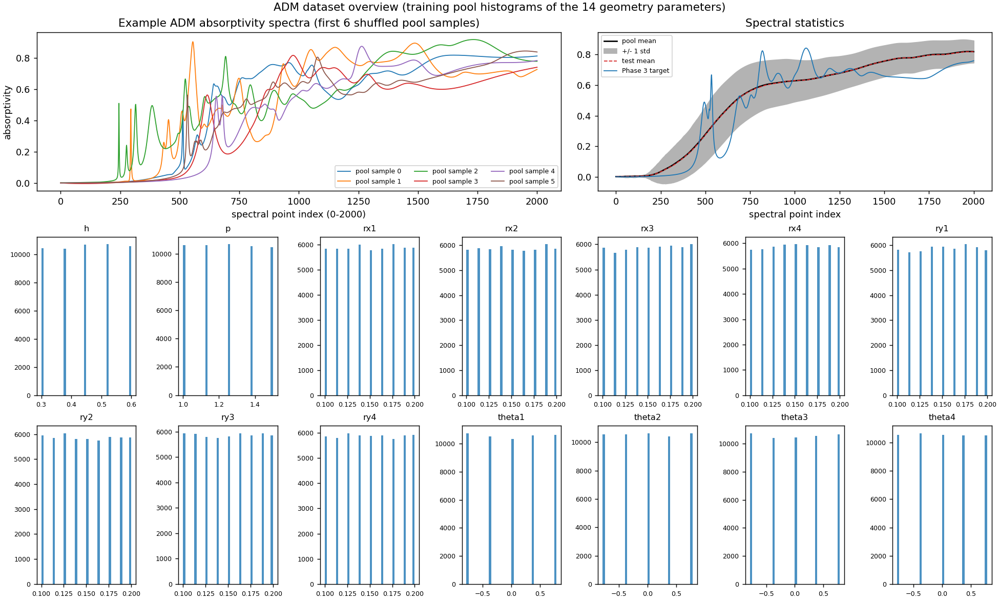

# Phase 1 summary: ADM data preparation

Generated 2026-11-06T20:00:11-05:00 by `phase1_data/prepare_data.py` in 30.0 s.

## Verification

| Check | Result |
|---|---|
| Archive bytes (expected 1,006,554,462) | 1,006,554,462 |
| Archive SHA-256 | `2cc0f3357a1a2caf880eb02e4b56f8d621a65876207ebd0fc8fd98e8ef325b02` |
| CRC check of all members | True |
| Geometry dimension (independent variables) | **14** (expected 14): True |
| Spectrum dimension (dependent variables) | **2001** (expected 2001): True |
| Row counts g/s match (pool, test) | True, True |
| All values finite | True |
| float64 -> float32 max abs error (g, s) | 2.22e-16, 5.55e-16 |

## Extracted files

| Member | Bytes |
|---|---|
| `ADM/data_g.csv` | 18,568,969 |
| `ADM/data_s.csv` | 2,642,665,729 |
| `ADM/testset/test_g.csv` | 2,063,193 |
| `ADM/testset/test_s.csv` | 293,624,872 |

## Partition

| Subset | Samples | Geometry shape | Spectrum shape | File |
|---|---|---|---|---|
| Training pool (shuffled, seed 2025) | 52,812 | (52812, 14) | (52812, 2001) | `data/processed/pool_{g,s}.npy` |
| Independent test set | 5,868 | (5868, 14) | (5868, 2001) | `data/processed/test_{g,s}.npy` |
| Total | 58,680 | | | |

Forward_Train protocol: D_k = first k pool rows; train:val = 10:1 (position i is validation iff i % 11 == 10); k0 = 500; data budget = 50,000 (max usable k = 50,000).

| k | train | val |
|---|---|---|
| 500 | 455 | 45 |
| 1,000 | 910 | 90 |
| 5,000 | 4,546 | 454 |
| 10,000 | 9,091 | 909 |
| 20,000 | 18,182 | 1,818 |
| 42,250 | 38,410 | 3,840 |
| 50,000 | 45,455 | 4,545 |

Inverse-design targets were pre-registered before any model was trained (seed 0): 100 test indices in `data/processed/inverse_test_idx.npy`; the Phase 3 target is test row 1546 (`phase3_inverse/target_spectrum.csv`).

## Geometry parameters (training pool)

Column order follows the manuscript's listing (the CSV has no header): h, p, rx1-rx4, ry1-ry4, theta1-theta4. Angles are in radians.

| # | Name | Min | Max | Mean | Std | Unique values |
|---|---|---|---|---|---|---|
| 0 | h | 0.3000 | 0.6000 | 0.4509 | 0.1058 | 5 |
| 1 | p | 1.0000 | 1.5000 | 1.2492 | 0.1765 | 5 |
| 2 | rx1 | 0.1000 | 0.2000 | 0.1501 | 0.0323 | 9 |
| 3 | rx2 | 0.1000 | 0.2000 | 0.1501 | 0.0323 | 9 |
| 4 | rx3 | 0.1000 | 0.2000 | 0.1504 | 0.0323 | 9 |
| 5 | rx4 | 0.1000 | 0.2000 | 0.1502 | 0.0321 | 9 |
| 6 | ry1 | 0.1000 | 0.2000 | 0.1502 | 0.0322 | 9 |
| 7 | ry2 | 0.1000 | 0.2000 | 0.1498 | 0.0324 | 9 |
| 8 | ry3 | 0.1000 | 0.2000 | 0.1500 | 0.0324 | 9 |
| 9 | ry4 | 0.1000 | 0.2000 | 0.1500 | 0.0323 | 9 |
| 10 | theta1 | -0.7854 | 0.7854 | -0.0016 | 0.5578 | 5 |
| 11 | theta2 | -0.7854 | 0.7854 | 0.0001 | 0.5556 | 5 |
| 12 | theta3 | -0.7854 | 0.7854 | -0.0002 | 0.5578 | 5 |
| 13 | theta4 | -0.7854 | 0.7854 | -0.0019 | 0.5548 | 5 |

## Spectra (training pool)

Absorptivity values span [-0.009991, 0.9999], mean 0.5180, std 0.3095. Predicting the pool-mean spectrum for every sample gives MSE = 0.01522 (a trivial baseline for the 2e-3 target).

## Duplicates

* Pool: 52,332 unique geometries, 480 extra duplicate rows.
* Test: 5,868 unique geometries, 0 extra duplicate rows.
* Geometries shared by pool and test: 0 (0 test rows).

## Independent audit

Audited 2026-11-06 by two independent auditors. Each wrote its own scripts and ran them from the repo root with `"$PY" -I`; neither used `prepare_data.py`. Neither modified anything under `framework/`, `data/raw/` or `data/processed/`. Scripts and results are in the session scratchpad, not in the repo: `C:/Users/93107/AppData/Local/Temp/claude/e00e894e93273985/276a685f-b10b-4810-ba63-bf0135edc817/scratchpad/phase1_audit_A/` and `C:/Users/93107/AppData/Local/Temp/claude/e00e894e93273985/276a685f-b10b-4810-ba63-bf0135edc817/scratchpad/phase1_audit_B/`.

### Auditor A: raw files and array fidelity

Verdict: PASS. 20 of 20 checks passed; 0 blocking issues.

| Check | Result | Detail |
|---|---|---|
| Audit method | PASS | `audit_a.py` (118 s), `audit_a2.py` (113 s); parsers: Python `float()` (correctly rounded), `np.loadtxt` |
| Raw line counts | PASS | data_g 52,812; data_s 52,812; test_g 5,868; test_s 5,868; 0 empty lines, 0 CR bytes, no BOM |
| g/s line counts match | PASS | pool 52,812 = 52,812; test 5,868 = 5,868 |
| Fields on every line | PASS | g 14, s 2001 on 100% of lines; 0 wrong lines; commas = rows x 13 and rows x 2000 |
| Strict number format | PASS | 0 lines off `%.18e`; bytes only `0-9 . e + - ,` and LF; 0 nan/inf; spectra 0 < abs(v) < 1 |
| All values finite | PASS | 0 unparseable, 0 non-finite of 118,240,200 values (sum of per-file counts; auditor text says 117,240,200) |
| Independent parser cross-check | PASS | `np.loadtxt` and pandas `round_trip` vs `float()`: max abs diff 0.0, 4 of 4 files |
| Archive to extracted fidelity | PASS | ADM.zip 1,006,554,462 B, SHA-256 match; 4 files + 2 dirs; size and CRC32 match 4 of 4 |
| Processed shapes and dtypes | PASS | pool_g (52812,14), pool_s (52812,2001), test_g (5868,14), test_s (5868,2001) float32; pool_perm (52812,) int64; all finite |
| pool_perm valid | PASS | permutation of 0..52811; 0 fixed points; = `default_rng(2025).permutation(52812)` |
| pool_g = float32(data_g[perm]) | PASS | 0 of 739,368 values differ (bitwise) |
| pool_s = float32(data_s[perm]) | PASS | 0 of 105,676,812 values differ (bitwise); g-s pairing kept |
| test_g = float32(test_g.csv) | PASS | 0 of 82,152 values differ; original row order |
| test_s = float32(test_s.csv) | PASS | 0 of 11,741,868 values differ; original row order |
| float32 cast unambiguous | PASS | max deviation 1.86e-8 of half a float32 ulp; 0 negative zeros |
| Geometry ranges | PASS | h [0.3, 0.6] 5 levels; p [1.0, 1.5] 5; rx1-4, ry1-4 [0.1, 0.2] 9; theta1-4 [-0.7854, 0.7854] 5; pool = test |
| Spectrum ranges | PASS | pool [-0.009991, 0.999875], mean 0.517976, std 0.309470, 0.71% < 0, 0 > 1; test [-0.009993, 0.998643], mean 0.517028, std 0.309565 |
| float32 error figures above | PASS | correct: 1.11e-16 (g), 4.44e-16 (s); Verification table: 2.22e-16, 5.55e-16 (pandas default parser); arrays unaffected |
| inverse_test_idx.npy | PASS | 100 unique int64 in [15, 5805]; includes 1546 |
| target_spectrum.csv | PASS | 1 x 2001; float32 = test_s row 1546 (bitwise); max abs diff 4.99e-11 |

Non-blocking issues:

* The float64-level figures above come from pandas' default parser. The float32 max error should read 1.11e-16 (g), 4.44e-16 (s). `data_summary.json` geometry min/max and the `phase3_inverse/target_info.json` thetas are 1 float64 ulp off. The float32 arrays are bitwise correct.
* `test_g.npy` and `test_s.npy` are Fortran-order; the pool arrays are C-order. `np.load` and the framework loaders handle both.
* Angle bounds are +/-0.7854 (float32 0.7853999734), not exactly pi/4 as `framework/TOOLS.md` says; difference 1.8e-6 rad.

### Auditor B: partition, leakage and inverse targets

Verdict: PASS. 24 of 24 reported checks passed; 0 blocking issues.

| Check | Result | Detail |
|---|---|---|
| A0 Strict raw parse (no pandas, no repo code) | PASS | 52812x14, 52812x2001, 5868x14, 5868x2001; no header; 0 bad lines or tokens; 0 non-finite; LF; 40 s |
| A0b Extracted CSVs = zip members | PASS | CRC32 and size match, 4 of 4 files |
| A1 pool_perm is a permutation | PASS | int64 (52812,); 52,812 unique; min 0, max 52811; 0 fixed points |
| A2 Seed reproduced | PASS | = `default_rng(2025).permutation(52812)`; 0 positions differ |
| A3 Pool arrays = float32(raw)[perm] | PASS | 0 mismatches; max abs diff vs float64 1.1e-16 (g), 4.4e-16 (s) |
| A4 Test arrays = float32(raw test) | PASS | 0 mismatches; original row order; 1.1e-16 (g), 4.4e-16 (s) |
| B1 Split k=500 | PASS | train 455, val 45, ratio 10.111; disjoint; = `common.split_positions(500)`; `load_dataset` bit-identical |
| B1 Split k=5,000 | PASS | train 4,546, val 454, ratio 10.013 |
| B1 Split k=20,000 | PASS | train 18,182, val 1,818, ratio 10.001 |
| B1 Split k=50,000 | PASS | train 45,455, val 4,545, ratio 10.001 |
| B2 Nesting of D_500, D_5000, D_20000, D_50000 | PASS | 6 of 6 pairs nested; 0 train/val flips; X/Y are exact prefixes |
| B3 Data budget feasible | PASS | 50,000 <= 52,812; 2,812 pool rows unused; VAL_PERIOD 11, K0 500 |
| B4 Train/val distribution shift | PASS | max grid-level frequency diff 0.016 (about 3 SE); mean-spectrum MSE 4.9e-6; train-mean baseline on val 1.533e-2 |
| C1 Test geometries in pool | PASS | 0 test rows under 4 key types |
| C2 Duplicates in pool | PASS | 480 pairs (960 rows); 52,332 unique; raw rows 28875-29361 repeated at 30834-31321; test 0 duplicates |
| C3 Duplicate-pair spectra | PASS | 0 of 480 bitwise identical; pair MSE mean 2.68e-5, median 5.4e-7, max 1.72e-3; noise floor about 1.34e-5 |
| C4 Train/val twins, k=50,000 | PASS | 70 of 4,545 val rows (1.54%); val MSE optimism <= 1.9e-5 (1.5% rel.); k=500/5,000/20,000: 0/2/11 |
| C5/C7 Spectral test-pool leakage | PASS | 0 exact copies; nearest-pool MSE min 2.07e-6, median 2.35e-3; 1 test row < 1e-4 (row 4123) |
| C8 Physically equivalent geometries | PASS | test row 4123 = pool raw row 50634 (ellipse permutation), MSE 2.07e-6; 0.017% of test; not an inverse target |
| D1 inverse_test_idx.npy | PASS | 100 unique int64 in [15, 5805]; first 1546; 0 target geometries in pool |
| D1b Target seed reproduced | PASS | = `default_rng(0).choice(5868, 100, replace=False)`; 0 differ |
| D2 target_spectrum.csv | PASS | 1 x 2001 = test_s[1546] (max abs diff 4.99e-11; float32 bitwise); runner-up max abs diff 0.2196; nearest pool MSE 1.20e-3 |
| D3 target_info.json | PASS | test_index 1546; geometry max abs diff 1.1e-16 vs raw; grid index [1,1,3,8,2,2,1,7,4,2,1,3,3,0] |
| E1 Summary numbers | PASS | 15 of 15 claims in `data_summary.json` match |

Non-blocking issues (dataset properties, relevant to Phase 2):

* Label noise: the 480 duplicate pairs come from one re-simulated block; pair MSE mean 2.68e-5, max 1.72e-3. Implied floor about 1.3e-5, about 1% of the 1.3e-3 target.
* Train/val twins at k=50,000: 70 of 4,545 val rows (1.54%); val MSE optimistic by at most 1.9e-5.
* Test row 4123 is a physical duplicate of a training row (pool position 37315), MSE 2.07e-6; 0.017% of test.

Overall audit verdict: PASS
