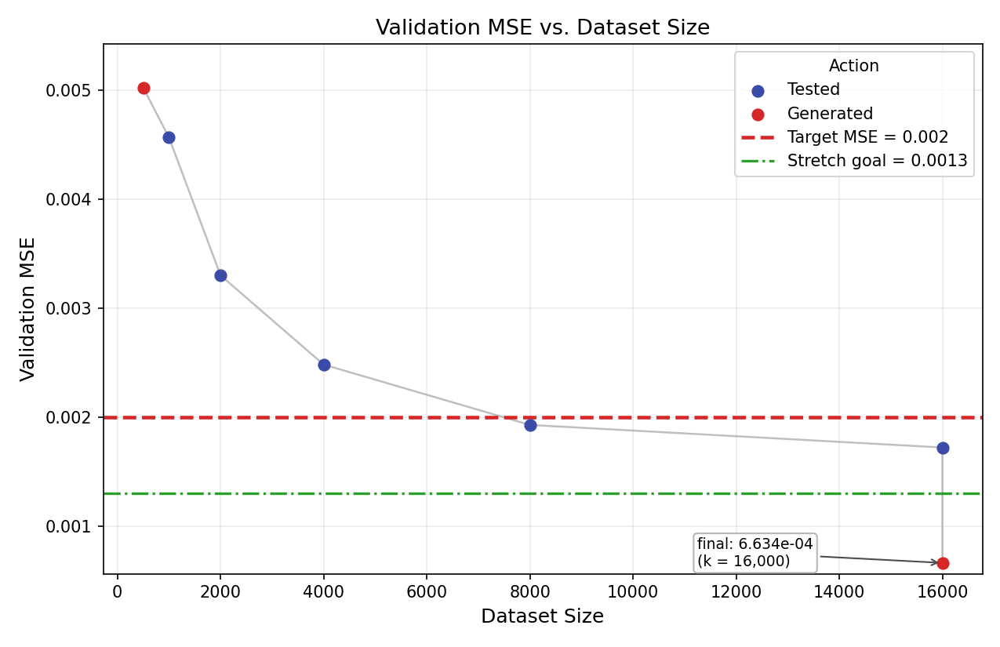
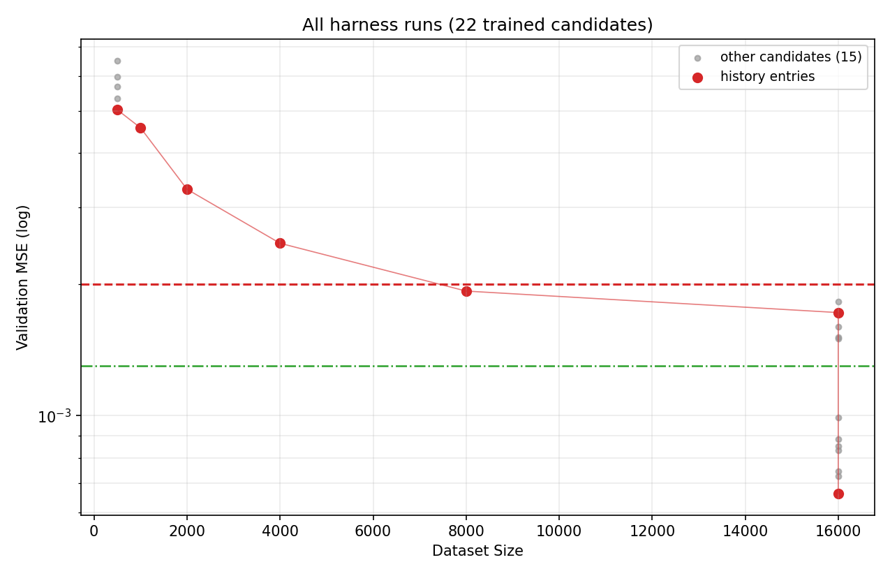
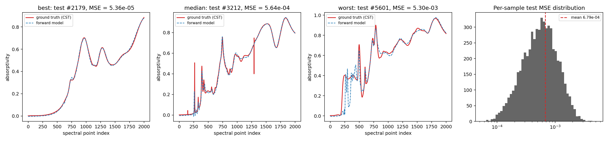

# Phase 2 (Forward_Train) summary: ADM forward surrogate

* **Final validation MSE 6.63e-4**, measured at k = 16,000 with 14,546 train and 1,454 val samples. That is **3.0x below the 2.0e-3 strict bound** and **2.0x below the 1.3e-3 stretch goal**, and 23x below the 1.52e-2 mean-spectrum baseline.
* **Independent test MSE 6.79e-4** on 5,868 held-out samples, 2.4% above validation. The test set was read once, after the model was frozen, and never used for selection.
* **Final model:** patch cross-attention transformer, **6,164,769 parameters**, trained for 720 s (229 epochs) on one RTX 4080 SUPER.
* **Stop reason: done** (stretch goal met) after 6 Controller rounds: 5 test and 1 generate. The phase used 16,000 of the 50,000-sample data budget (32%).
* **Runtime:** Phase 2 wall clock 2:44:05. Total GPU training time 3:01:25 over 22 harness runs, none of which failed.

| Item | Value |
|---|---|
| Final run | `r06_explore_patchxattn_s32-1106-221446-49f4` (round 6, AIDE `explore` node) |
| Source file | `phase2_forward/solutions/r06_explore_patchxattn_s32.py` (sha256 `6c81ed15...5966b`) |
| Final model package | `phase2_forward/final_model/`: `solution.py`, `best_model.pt`, `scaler.json`, `result.json` |
| Val MSE recomputed by `final_eval.py` | 6.6336e-4. Relative difference from the harness value: 0.0 |
| Other outputs | `final_eval.json`, `runtime.json`, `memory/{history,archive,decisions,final}.json` |

## Final architecture details

The model is an encoder-decoder transformer that maps geometry to spectrum. A V4-invariant geometry encoder feeds a decoder of spectral patch queries (Perceiver-IO / DETR style), which replaces the incumbent's MLP head. The layers below come from the solution docstring and from `model_repr` in `result.json`, using d_model 256 and 8 heads throughout.

| # | Stage | Layers | Output | Params |
|---|---|---|---|---|
| 0 | Input scaling (harness) | minmax to [-1, 1], fitted on train | (B, 14) | - |
| 1 | Invariant features (no weights) | per resonator i: s = rx+ry, u, v = (rx-ry)cos/sin 2theta, \|d\| = sqrt(u^2+v^2+0.1^2), u/\|d\|, v/\|d\|, h, p; global token input (h, p) | (B,4,8), (B,2) | 0 |
| 2 | Resonator embedding, shared by the 4 resonators | Linear(8->256), GELU, Linear(256->256) | (B,4,256) | 68,096 |
| 3 | Global embedding | Linear(2->256), GELU, Linear(256->256) | (B,1,256) | 66,560 |
| 4 | Geometry encoder, 2 x EncBlock | pre-LN 8-head self-attention (qkv Linear(256->768), out Linear(256->256)) plus a learned per-head logit bias over 7 relation types: resonator pair i XOR j (0..3), global-global, global->res, res->global. This makes the encoder exactly invariant to the supercell-shift permutations. Then a pre-LN FFN Linear(256->1024), GELU, Linear(1024->256), with residual dropout 0.1 | (B,5,256) | 2 x 789,816 |
| 5 | Encoder norm | LayerNorm(256), giving the geometry memory M | (B,5,256) | 512 |
| 6 | Pooled latent | z = [M_global, mean(M_res)]: Linear(512->256), GELU, Linear(256->256) | (B,256) | 197,120 |
| 7 | Patch queries | P = ceil(2001/32) = 63 tokens = learned position table (63x256) + z | (B,63,256) | 16,128 |
| 8 | Patch decoder, 4 x DecBlock | (a) pre-LN patch self-attention with a learned relative-position bias (8 heads x 125 offsets; 4 heads ALiBi-initialised, slopes 1/2 to 1/16); (b) pre-LN cross-attention to the 5 geometry tokens (q 256->256, kv 256->512, out 256->256); (c) pre-LN FFN 256->1024->256 with GELU; residual dropout 0.1 | (B,63,256) | 4 x 1,054,440 |
| 9 | Decoder norm | LayerNorm(256) | (B,63,256) | 512 |
| 10 | Shared renderer | Linear(256->64), applied to every patch token | (B,63,64) | 16,448 |
| 11 | Overlap-add, crop, bias | neighbouring patch halves summed, equivalent to ConvTranspose1d with kernel 64 and stride 32. This gives 64 x 32 = 2,048 points, centre-cropped (offset 23) to 2,001, plus a learned per-point bias | (B,2001) | 2,001 |
| 12 | Output scaling (harness) | y_raw = 0.3093 * y + 0.5181 (global_standard) | (B,2001) | - |
| | **Total** | encoder 1,579,632; decoder 4,217,760 | | **6,164,769** |

* **Buffers:** the 5x5 relation matrix and the 63x63 patch-offset index. There are no fixed random tensors.
* **Smoothness:** all activations are GELU and nothing is clamped, so the model can be differentiated with respect to the input for the Phase 3 Neural-Adjoint.
* **Scaling:** `adapt_config` scales the batch size, lr, width, depth, EMA and epoch cap with n_train. At n_train = 14,546 it selects the settings below.

**Training recipe** (from `result.json` config and the run record):

| Setting | Value |
|---|---|
| Data | D_16000: 14,546 train / 1,454 val (pool position i is val iff i % 11 == 10) |
| Loss | MSE on scaled y (custom `compute_loss`). With global y scaling this equals the raw metric times a constant |
| Augmentation | random all-angle sign flip (theta_1..4 -> -theta_1..4) with p = 0.5 per sample (mirror symmetry) |
| Input scaling | minmax to [-1, 1], fitted on train: h (h-0.45)/0.15, p (p-1.25)/0.25, semi-axes (r-0.15)/0.05, angles theta/(pi/4) |
| Output scaling | global_standard: y_scaled = (y - 0.5181)/0.3093. The harness inverts it for the metric |
| Optimizer | fused AdamW, peak lr 1e-3, betas (0.9, 0.98). Weight decay 0.05 applies to weight matrices only; biases, LayerNorms, relation and position bias tables, position embeddings and the output bias get none |
| Schedule | per-step cosine: linear warmup of 8.77 epochs (about 500 steps), floor at 1% of peak (1e-5). Time-aware: progress = max(step progress, elapsed / 720 s) |
| Epochs | 754 planned (cap = 2x the solo-timing estimate), **229 run**. The 720 s time limit stopped the run with the lr at its floor; the best epoch was 229, the last one |
| Batch size | 256 (57 steps/epoch, about 13,050 optimizer steps) |
| Gradient clipping | global norm 1.0 |
| EMA | weight EMA, decay 0.99814 (horizon about 540 steps). Validation and the saved checkpoint use the EMA weights |
| Precision (AMP) | bf16 autocast and TF32 matmuls for training. Evaluation runs in fp32 with TF32 off |
| Regularisation | residual dropout 0.1, no attention dropout, no early stopping. Final train loss 2.54e-3 in scaled units (about 2.4e-4 raw, with dropout and augmentation active) |
| Other | seed 0; validation every epoch; best checkpoint kept; 720.23 s training at 3.02 s/epoch plus 2.45 s setup; torch 2.5.1+cu121 |

<details><summary>model_repr (from result.json)</summary>

```
PatchXAttnTransformer(
  (res_embed): Sequential(Linear(8, 256), GELU, Linear(256, 256))
  (glob_embed): Sequential(Linear(2, 256), GELU, Linear(256, 256))
  (enc): ModuleList((0-1): 2 x EncBlock(
      (n1, n2): LayerNorm(256)
      (att): SelfAttn((qkv): Linear(256, 768), (o): Linear(256, 256))
      (ff): Sequential(Linear(256, 1024), GELU, Linear(1024, 256))
      (drop): Dropout(p=0.1)))
  (enc_norm): LayerNorm(256)
  (z_proj): Sequential(Linear(512, 256), GELU, Linear(256, 256))
  (dec): ModuleList((0-3): 4 x DecBlock(
      (n1, n2, n3): LayerNorm(256)
      (sa): SelfAttn((qkv): Linear(256, 768), (o): Linear(256, 256))
      (ca): CrossAttn((q): Linear(256, 256), (kv): Linear(256, 512), (o): Linear(256, 256))
      (ff): Sequential(Linear(256, 1024), GELU, Linear(1024, 256))
      (drop): Dropout(p=0.1)))
  (dec_norm): LayerNorm(256)
  (out): Linear(256, 64)
)
+ parameters: pos (63x256), out_bias (2001), enc[i].rel_bias (8x7), dec[i].rel_pos (8x125)
```
</details>

## Runtime

| Quantity | Seconds | h:mm:ss |
|---|---|---|
| **Phase 2 wall clock** (start to loop_end) | 9,845 | **2:44:05** |
| **Total GPU training time**, all 22 ledger runs (22 done, 0 failed) | 10,884.91 | **3:01:25** |
| - round 0: 6 AIDE nodes at k = 500 | 1,080.59 | 0:18:01 |
| - rounds 1-5: 5 test runs (k = 1,000 to 16,000) | 1,862.56 | 0:31:03 |
| - round 6: 11 AIDE nodes at k = 16,000 | 7,941.76 | 2:12:22 |
| **Final model training time** | 720.23 | **0:12:00** |

* **Timestamps:** start 2026-11-06T20:22:04-05:00; first run submitted at 20:46:53; last run finished at 23:03:44; loop_end 2026-11-06T23:06:09-05:00.
* **Why GPU time exceeds wall clock:** up to 3 harness runs train concurrently on the one GPU.
* **Counts:**
  * 6 rounds after initialization: 5 test and 1 generate, plus the round-0 initialization generate.
  * 7 Controller decisions; the 7th is `done`.
  * 17 AIDE nodes in the archive: 6 in round 0 and 11 in round 6.
  * 22 trained candidates in the ledger.
* **Details:** `runtime.json`.

## Validation MSE vs dataset size





The first plot shows one history event per round: tested in blue, generated in red. The second shows all 22 harness runs on a log scale, with grey points for the 15 non-history candidates.

## History

The reasons below are condensed. The full Controller text is in `memory/history.json` and `memory/decisions.json`. S is the training-time budget per run.

| Round | Action | k (train / val) | S (s) | Val MSE | Params | Reason |
|---|---|---|---|---|---|---|
| 0 | generate | 500 (455 / 45) | 180 | 5.02e-3 | 6.13M | Initialization: AIDE drafted 3 families (6 nodes). The best was a V4 relational transformer with shape-tensor resonator tokens |
| 1 | test | 1,000 (910 / 90) | 180 | 4.57e-3 | 6.13M | Train MSE about 2e-5 vs val 5.0e-3, so the model is data-limited, not capacity-limited. Measure the first MSE-vs-size slope |
| 2 | test | 2,000 (1,819 / 181) | 180 | 3.30e-3 | 6.13M | The first doubling gave only -9%, but 45 and 91 val samples are too noisy to call saturation. Confirm the trend |
| 3 | test | 4,000 (3,637 / 363) | 300 | 2.48e-3 | 6.13M | -28% per doubling (local exponent -0.47): still data-limited, so adding data is efficient |
| 4 | test | 8,000 (7,273 / 727) | 480 | 1.93e-3 | 6.92M | -25% (exponent -0.41), mild diminishing returns. The power law projects about 1.9e-3 at 8,000, below the bound |
| 5 | test | 16,000 (14,546 / 1,454) | 720 | 1.72e-3 | 11.56M | -22% (exponent -0.36) and the strict bound is met. Test once more before spending a generate round |
| 6 | generate | 16,000 (14,546 / 1,454) | 720 | **6.63e-4** | 6.16M | Only -11% (exponent -0.16). Extrapolating to 50,000 gives about 1.43e-3, which misses the 1.3e-3 goal: the incumbent is saturating, so regenerate code with AIDE |
| 7 | done (decision only) | 16,000 | - | - | - | Target reached: 3.0x below the bound and 2.0x below the goal. All 5 refinements stayed below 1e-3, so the remaining 34,000 CST simulations are not needed |

The test rounds re-ran the incumbent file unchanged. Its `adapt_config` grows the batch size and model size with n_train, which is why the parameter count rises from 6.13M to 11.56M.

What `adapt_config` actually built in each test round. The source file (sha `f86849c7...`) was identical in rounds 0-5. The values come from each run's `result.json` config:

| k | Blocks | d_model | MLP head | Batch | Peak lr | Dropout | Weight decay | Params |
|---|---|---|---|---|---|---|---|---|
| 500, 1,000 | 3 | 256 | 2 x 1024 | 64 | 8.49e-4 | 0.10 | 0.05 | 6.13M |
| 2,000, 4,000 | 3 | 256 | 2 x 1024 | 64 | 8.49e-4 | 0.08 | 0.03 | 6.13M |
| 8,000 | 4 | 256 | 2 x 1024 | 128 | 1.2e-3 | 0.05 | 0.02 | 6.92M |
| 16,000 | 4 | 320 | 2 x 1536 | 256 | 1.5e-3 | 0.02 | 0.01 | 11.56M |

The `architecture` strings stored in `memory/history.json` for rounds 1-5 describe the code, so they repeat the round-0 text. The table above shows the network that code actually built at each k. The paper's Algorithm 1 likewise re-runs unchanged code in a `test` action. Here, the code scales its own capacity with the data, a design decision made by the AIDE agent. The per-run training budget S came from the workflow: 180 s up to k = 2,000, then 300 s, 480 s and 720 s. The Planner's `memory/plan.md` had proposed 300 s and 600 s for the two largest sizes.

## Best val MSE per architecture family (AIDE archive)

| Family | Nodes | Best val MSE | k | Params | Best node |
|---|---|---|---|---|---|
| **Patch cross-attention decoder**: V4 relational geometry encoder plus spectral patch queries (self- and cross-attention, shared overlap-add renderer) | 7 | **6.63e-4** | 16,000 | 6.16M | `r06_explore_patchxattn_s32` |
| Deep ensemble (M = 4) of the incumbent V4 relational transformer with MLP head | 3 | 1.50e-3 | 16,000 | 46.3M | `r06_recipe_ens4wd` |
| Incumbent encoder with a shared-renderer patch MLP head (no attention) | 1 | 1.60e-3 | 16,000 | 12.7M | `r06_improve_patchhead` |
| V4-exact relational transformer with MLP head, the incumbent of rounds 0-5 (it reached 1.72e-3 at k = 16,000 in round 5) | 2 | 5.02e-3 | 500 | 6.13M | `r00_draft2_v4tfshape` |
| Relational / orbit-averaged encoder with a rank-64 basis and FiLM transposed-conv decoder | 2 | 5.04e-3 | 500 | 6.48M | `r00_draft3_relconv` |
| Residual-MLP deep ensemble (M = 4) with V4 and angle-flip orbit averaging | 2 | 5.67e-3 | 500 | 34.5M | `r00_draft1_v4flip` |

Rows at k = 500 (S = 180 s, 45 val samples) are not comparable with rows at k = 16,000 (S = 720 s, 1,454 val samples).

**The AIDE search tree is seeded with the incumbent.** In a generate round after initialization, the incumbent is the root node of AIDE's tree. In round 6 that root was r05, which had already been scored at the round's k = 16,000 and S = 720 s. The improve and recipe operators branch from the root, so a generate round can never end worse than the incumbent. Round 0 had no incumbent and started from 3 drafts. The round-6 tree (k = 16,000, S = 720 s):

```
root  r05 incumbent: V4 relational transformer + 2x1536 MLP head (11.56M)        1.72e-3
|- improve        ens4: 4-member batched deep ensemble of the root (46.3M)        1.51e-3
|- improve        patchhead: root encoder + shared-renderer patch MLP head (12.7M) 1.60e-3
|- recipe         ens4wd: 4-member ensemble + effective weight decay 0.10 (46.3M) 1.50e-3
|  `- recipe      ens4sam: + SAM, rho 0.1 (46.3M)                                 1.82e-3
`- explore        patchxattn: patch cross-attention decoder, S = 64 (6.17M)       8.34e-4
   `- explore     patchxattn_s32: S = 32 patches (6.16M)   <- FINAL                6.63e-4
      |- refine_arch    adaLN decoder conditioning (8.66M)                        7.27e-4
      |- refine_arch    S = 16 patches (6.18M)                                    7.45e-4
      |- refine_hparam  batch 128 (*)                                             8.50e-4
      |- refine_hparam  lr 2e-3 (*)                                               8.84e-4
      `- refine_hparam  dropout 0 (*)                                             9.88e-4
(*) ran under heavy GPU contention: 6.5-10.9 s/epoch vs 3.0, so only 65-107 epochs
```

## Test-set check (final model only, never used for selection)

| Statistic | Value |
|---|---|
| n_test | 5,868 |
| **Test MSE** (mean over samples and 2,001 points, raw absorptivity) | **6.79e-4** |
| Test / val ratio | 1.024 |
| Per-sample MSE, median | 5.64e-4 |
| Per-sample MSE, 95th percentile | 1.59e-3 |
| Per-sample MSE, min / max | 5.36e-5 / 5.30e-3 |



* **Best** (#2179): a smooth spectrum, traced almost exactly.
* **Median** (#3212): the broad bands and most resonances are right, but the model undershoots the sharpest one-point spikes (near points 270 and 1300).
* **Worst** (#5601): the model puts spurious narrow resonances in points 200-550, where the CST spectrum has a plateau.
* **Overall:** per-sample MSE is roughly log-normal around 5e-4, and 95% of test samples fall below 1.6e-3. The residual is concentrated in the sharpest peaks, which matches the validation diagnostic: 54% of the squared error sits at the 10% steepest points.

## How the Controller balanced data growth and code generation

* **Round 0 (generate, k0 = 500):** AIDE drafted 3 families and improved each once. The V4 relational transformer won at 5.02e-3. It memorised its 455 training samples (train MSE about 2e-5), so the error was data-limited.
* **Rounds 1-5 (test):** the Controller grew k by doubling, from 500 to 16,000, and re-ran the same file. It tracked the local power-law exponent of val MSE vs k:

  | Doubling | 500->1k | 1k->2k | 2k->4k | 4k->8k | 8k->16k |
  |---|---|---|---|---|---|
  | Exponent | 0.14 | 0.47 | 0.41 | 0.36 | 0.16 |

  * The first value was treated as noise from the 45-sample validation split.
  * The strict bound was crossed at k = 8,000 (1.93e-3).
* **Round 6 (generate, same k):** the 8k->16k doubling gave only -11%, and the extrapolation to the full 50,000 budget (about 1.43e-3) missed the stretch goal. The Controller therefore switched to code generation at k = 16,000 instead of buying 34,000 more simulations. AIDE's 11-node search replaced the MLP head with a patch cross-attention decoder. This cut val MSE from 1.72e-3 to 6.63e-4 (-61%) with about half the parameters.
* **Round 7 (done):** the Controller stopped under termination rule 1 (stretch goal met). It had used 32% of the data budget and one code-generation round after initialization.
* **Why the switch worked:** the round-6 diagnostics showed that the incumbent's remaining error was systematic and shared across ensemble members. Recipe changes (weight decay, SAM) and ensembling gained at most 13%. The gain came from changing how the output is parameterised.

## Independent verification (3 verifier agents)

| Verifier | Scope | Verdict |
|---|---|---|
| A: metrics | Rebuilt the final model from the snapshot and recomputed val MSE (fp32 and fp64-CPU), the data split, leakage and duplicates | **pass** |
| B: protocol | Framework sha256 unchanged, data grants, Controller hard rules, AIDE tree seeding, ledger, test-set isolation | **pass** |
| C: report and plot | Numbers across JSON, ledger and plot; runtime recomputed; test MSE recomputed (4.7e-8 relative) | **pass after fix**: first `fail`, because this file had not been written |

Notes the verifiers raised. None of them changes a reported number:

* **Duplicate geometries.** 8 of the 1,454 validation geometries also appear in the training split, with spectra that differ by up to 0.055. These duplicates exist in the original pool, which has 480 duplicate rows. Excluding them, val MSE is 6.663e-4 (+0.45%).
* **Missing candidate files.** `solutions/` does not hold every candidate. `r06_improve_ens8.py` was deleted by its agent before submission; only its `.pyc` remains. `r06_recipe_ens4.py` was written but never submitted. Every *trained* candidate has a code snapshot in `runs/<run_id>/solution.py`.
* **Diagnostic scripts.** Some AIDE agents imported `framework/common.py` and `framework/harness.py` in scripts run outside the harness, using only data they had been granted. No test data was touched. Figures quoted from those diagnostics are not harness numbers. Example: 54% of squared error sits at the 10% steepest points.
* **Controller soft rules.** The Controller twice departed from the Planner's rules: it tested again after round 1, citing noise on 45 validation samples, and in round 6 it generated at k = 16,000 instead of testing at 12,000. Every hard rule in the workflow held.
* **Plot fix.** The val MSE plot was redrawn from the same `memory/history.json` after one presentation change to `framework/plot_history.py`: the final-point label now sits in a boxed position clear of the stretch-goal line.

Supporting files:

* The summary text was drafted by the Reporter agent. Its file write was blocked because subagents may not write report files, so the orchestrator wrote this file and checked every number against the JSON files above.
* The verifier scripts are under the session scratchpad: `phase2_verify_A/`, `phase2_verify_B/`, `phase2_verify_C/`.
