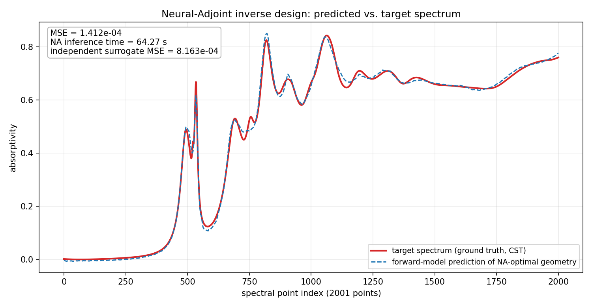
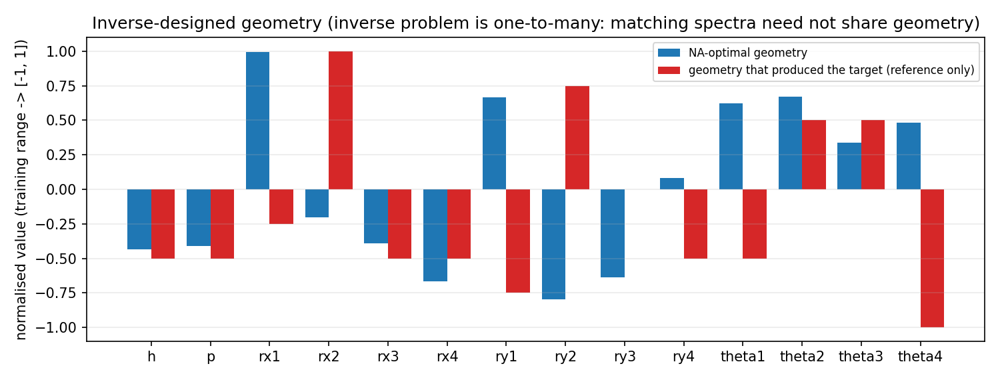
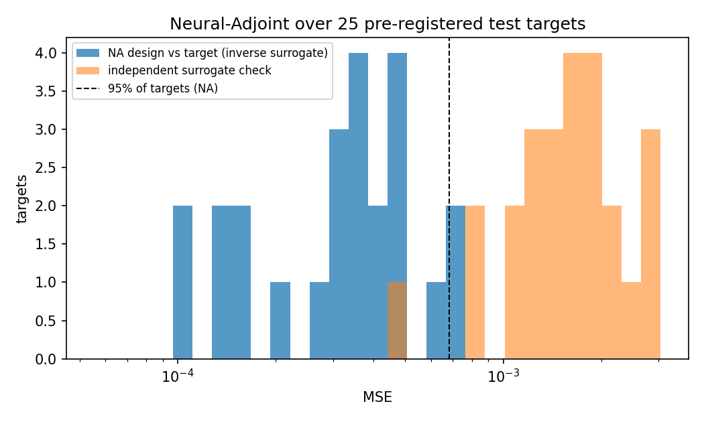
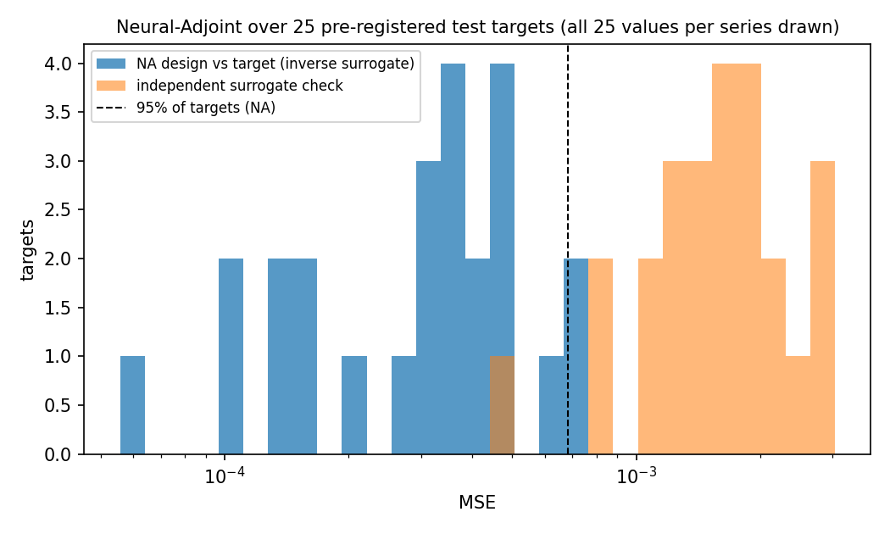

# Phase 3: Neural-Adjoint inverse design (Inverse Designer agent)

**Optimal 14-D geometry** (order h, p, rx1-rx4, ry1-ry4, theta1-theta4; full precision in `na_result/optimal_geometry.csv`):
`[0.384707, 1.146940, 0.199713, 0.139861, 0.130475, 0.116735, 0.183186, 0.110109, 0.118081, 0.154211, 0.489493, 0.526385, 0.265319, 0.377324]`

**Forward-model-predicted MSE vs the target: 1.412e-4. NA inference time: 64.27 s.** This MSE of the continuous optimum is the optimiser's optimistic in-model error, not its expected accuracy: the optimiser minimised it directly, and the independent check model scores the same design at 8.163e-4. The optimum is off the data grid in 12 of 14 coordinates; when a data-supported (on-grid) design is needed, the recommendation is the best of its 2^14 floor/ceil grid neighbours found by verifier C, `[0.375, 1.125, 0.2, 0.1375, 0.125, 0.125, 0.1875, 0.1125, 0.125, 0.15, 0.3927, 0.3927, 0, 0.3927]` (forward model 2.802e-4, check model 5.534e-4; see Independent verification).

| Quantity | Value |
|---|---|
| Predicted MSE, NA design vs target (forward model, full fp32) | **1.4115e-4** (RMSE 0.0119) |
| Best stage-1 MSE → final polished MSE | 1.5949e-4 → 1.4115e-4 (−11.5%) |
| Forward-model MSE of the true (source) geometry | 2.5605e-4 |
| Independent check model: NA design / true geometry (its error floor) | 8.163e-4 / 5.517e-4 (1.48x the floor) |
| **NA inference time** (CUDA-synchronised; model loaded, kernels warmed up) | **64.27 s** |
| — stage 1: 2048 random starts × 500 bf16 Adam steps, then fp32 re-scoring of all 2048 | 47.85 s |
| — stage 2: 64 best × 2000 exact-fp32 Adam steps, their re-scoring, ranking of all candidates | 16.42 s |
| Model load time | 0.243 s |
| Total tool wall time (whole command, `time`) | 69.46 s |
| 25 test targets: NA MSE mean / median / p95 | 3.387e-4 / 3.363e-4 / 6.836e-4 |
| 25 test targets: independent-check MSE mean vs its floor mean | 1.670e-3 vs 1.553e-3 |
| 25 test targets: NA time per design | 64.95 s (std 1.51 s) |

Run: 2026-11-07 01:10:46–01:11:56 (−05:00) on an NVIDIA GeForce RTX 4080 SUPER. Tool: `framework/neural_adjoint.py` (sha256 ddfa728e…b477). Forward model: `na_model/`, the Phase 2 final model r06_explore_patchxattn_s32-1106-221446-49f4 (6.16M params, test MSE 6.79e-4).

## 1. Optimal geometry

| Parameter | NA-optimal value | Training range (min – max) | Source geometry of the target (reference only, never given to the optimiser) |
|---|---|---|---|
| h | 0.3847 | 0.30 – 0.60 | 0.3750 |
| p | 1.1469 | 1.00 – 1.50 | 1.1250 |
| rx1 | 0.1997 | 0.10 – 0.20 | 0.1375 |
| rx2 | 0.1399 | 0.10 – 0.20 | 0.2000 |
| rx3 | 0.1305 | 0.10 – 0.20 | 0.1250 |
| rx4 | 0.1167 | 0.10 – 0.20 | 0.1250 |
| ry1 | 0.1832 | 0.10 – 0.20 | 0.1125 |
| ry2 | 0.1101 | 0.10 – 0.20 | 0.1875 |
| ry3 | 0.1181 | 0.10 – 0.20 | 0.1500 |
| ry4 | 0.1542 | 0.10 – 0.20 | 0.1250 |
| theta1 (rad) | 0.4895 | −0.7854 – 0.7854 | −0.3927 |
| theta2 (rad) | 0.5264 | −0.7854 – 0.7854 | 0.3927 |
| theta3 (rad) | 0.2653 | −0.7854 – 0.7854 | 0.3927 |
| theta4 (rad) | 0.3773 | −0.7854 – 0.7854 | −0.7854 |

- All 14 values lie inside the training range. rx1 is 0.0003 below its upper limit. Lengths are in the data set's units; angles are in rad.
- The design is not the source geometry: their mean normalised distance is 0.357 (mean of |design − source| / range over the 14 parameters).
- Much of that gap comes from how the resonators are labelled. Swap the source's resonators 1↔2 and 3↔4 (a V4 relabelling; for each of the four V4 relabellings of either geometry, both surrogates return the same MSE to the 5 significant digits printed). Then h, p and the eight semi-axes of the design lie within 0.010, 0.022 and 0.0083 of the source (one semi-axis grid step is 0.0125), and the mean normalised distance falls to 0.125.
- The angles still differ after relabelling: theta1 by 0.10 rad, theta4 by 0.02 rad, theta2 by 0.92 rad and theta3 by 1.05 rad. Resonator 3 of the relabelled source is a circle (rx = ry = 0.125), so its angle has no geometric effect.

## 2. Predicted spectrum vs target

Red: the CST target (test row 1546). Blue dashed: the forward-model prediction for the NA design. The values in the box (MSE 1.412e-04, 64.27 s, independent surrogate MSE 8.163e-04) match `na_result.json`. Pearson r = 0.9992. Everything below was checked numerically against `na_result/predicted_spectrum.csv` and `target_spectrum.csv`.

**Main resonances.** The target has 14 extrema with prominence ≥ 0.05. For each of them, the prediction has an extremum of the same type within 26 points. (Prediction wiggles with prominence below 0.001 are ignored.) For 12 of the 14 the shift is 6 points or less, and for 13 of the 14 the heights agree within 0.03 (Δ = prediction − target):

| Target extremum | Target index / value | Prediction index / value | Δ index | Δ height |
|---|---|---|---|---|
| peak | 494 / 0.489 | 495 / 0.498 | +1 | +0.009 |
| dip | 515 / 0.380 | 520 / 0.400 | +5 | +0.020 |
| peak (largest prominence, 0.54) | 534 / 0.668 | 534 / 0.616 | 0 | **−0.052** |
| dip | 581 / 0.123 | 584 / 0.107 | +3 | −0.016 |
| peak | 692 / 0.530 | 688 / 0.525 | −4 | −0.005 |
| dip | 727 / 0.450 | 728 / 0.479 | +1 | +0.029 |
| peak | 819 / 0.825 | 820 / 0.850 | +1 | +0.025 |
| dip | 868 / 0.625 | 873 / 0.612 | +5 | −0.012 |
| peak | 906 / 0.678 | 905 / 0.696 | −1 | +0.019 |
| dip | 961 / 0.581 | 964 / 0.584 | +3 | +0.003 |
| peak (target maximum) | 1063 / 0.843 | 1057 / 0.837 | −6 | −0.005 |
| dip | 1143 / 0.647 | 1160 / 0.666 | **+17** | +0.019 |
| peak | 1196 / 0.709 | 1195 / 0.696 (weak: prominence 0.017 vs 0.063) | −1 | −0.013 |
| dip (broad) | 1706 / 0.642 | 1680 / 0.636 | **−26** | −0.007 |

**Small features (target prominence < 0.05):**
- Missed: the shoulder at 522 (peak 0.444) / 524 (dip 0.434), prominence 0.009. The prediction rises monotonically from its dip at 520 to its peak at 534.
- Missed: the small peak at 756 (0.536) and dip at 771 (0.515), prominence 0.021. Between 728 and 820 the prediction has no extremum of prominence ≥ 0.005, only a 0.004 dip at 744–751. At 756 the prediction is 0.487 (−0.049).
- Shifted: the dip at 1246 (0.679) and peak at 1310 (0.709) appear 22 and 21 points lower (0.680 at 1224, 0.712 at 1289).
- Shifted and flattened: the dip at 1373 (0.661) and peak at 1426 (0.684) appear 12 and 22 points higher (0.663 at 1385, 0.675 at 1448). The predicted peak's prominence is 0.012 vs 0.023.

**Where the error sits** (the bands cover all 2001 points):

| Band (spectral index) | Points | Share of squared error | Band MSE |
|---|---|---|---|
| 0–399 (target ≤ 0.039) | 400 | 4.0% | 2.79e-5 |
| 400–799 | 400 | 49.3% | 3.48e-4 |
| 800–1199 | 400 | 34.3% | 2.42e-4 |
| 1200–2000 | 801 | 12.4% | 4.38e-5 |

- The windows 500–540 (41 points) and 740–770 (31 points) carry 16.1% and 12.5% of the squared error. The 20 largest absolute errors lie at 505–512, 533–535 and 751–759.
- The largest error is +0.053 at index 508 (prediction 0.469 vs target 0.416), where the prediction falls off more slowly after the 494/495 peak.
- In 0–399 the prediction lies below the target at all 400 points (mean residual −0.005). It is negative at indices 0–244 (minimum −0.0071 at index 9), while the target's minimum is −0.0006.

The figure shows the normalised values (training range → [−1, 1]) of the design (blue) and of the source geometry (red); the bar heights match the table (e.g., rx1: design +0.99, source −0.25). The red ry3 bar has zero height because the source's ry3 = 0.150 is the middle of the range. The figure compares parameters label by label; Section 1 gives the comparison after resonator relabelling.

## 3. Stage 1 vs polished
- Best stage-1 candidate (fp32 re-scored): 1.5949e-4. After 2000 polish steps on the 64 best candidates: 1.4115e-4 (−11.5%). The returned design is a polished candidate.
- The median stage-1 candidate MSE is 4.406e-3, about 28x the best. 4 of the 2048 candidates left the domain before projection.
- The 10 best candidates span 1.4115e-4 to 1.4650e-4. The 2nd and 3rd (1.41387e-4 each, to 6 significant digits) are a 1↔2 / 3↔4 relabelling of each other, with all four angles negative. The returned design has all four angles positive.

## 4. GPU load from other applications
- The GPU (RTX 4080 SUPER, 16376 MiB) is shared with the user's desktop.
- Before the single run (8 samples, 01:10:24–01:10:40): utilisation 17–28% (mean 20.9%), 1959 MiB used. nvidia-smi listed 42 desktop processes as GPU users (e.g., Wallpaper Engine, Chrome, Edge WebView2, Adobe Illustrator, Slack) and no Python process.
- After the single run: 9–19%, 1985 MiB. At the start of each of the 4 batch calls: 17–27%, 1827–1994 MiB; no Python process at the last three (the first was not checked; its 1994 MiB matches the desktop-only level).
- Per-design times in the batch ranged from 63.4 to 69.5 s.

## 5. Independent-surrogate check
- Check model: run **r06_recipe_ens4wd-1106-215908-6c5a**, a 4-member deep ensemble of the V4 relational transformer with a global MLP head (46.25M params). Its Phase 2 **val MSE is 1.503e-3** (re-validated identical at export). It belongs to a different architecture family from the NA model but uses the same D_16000 training split and scalers.
- **NA design: 8.163e-4. Error floor (the check model on the true geometry): 5.517e-4.** The ratio is 1.48, the third-highest of the 25 batch targets (median ratio 1.03).
- The first run's design (previous tool version) scored 6.220e-4 with the check model. For this target, the longer polish lowered the forward-model MSE (1.487e-4 → 1.412e-4) while the check-model MSE rose (6.220e-4 → 8.163e-4).

## 6. Forward-model MSE of the true geometry
- The forward model scores the source geometry at **2.5605e-4**. The NA design (1.4115e-4) is 44.9% lower.
- This does not show that the design is physically better. NA minimises the surrogate's error, including the surrogate's own mistakes, and the independent check scores the design worse than the true geometry (8.163e-4 vs 5.517e-4).
- Over the 25 targets, the NA MSE is below the forward-model MSE of the true geometry for 25 of 25 (means 3.387e-4 vs 7.334e-4).

## 7. Statistics over 25 pre-registered test targets
The batch used the first 25 of the 100 indices in `data/processed/inverse_test_idx.npy`. The first is 1546, the main target, and it was reproduced exactly (same geometry, same MSE 1.4115e-4, 64.16 s).

| Quantity | Mean | Median | p95 | Min – max |
|---|---|---|---|---|
| NA MSE (forward model) | 3.387e-4 | 3.363e-4 | 6.836e-4 | 5.57e-5 – 7.58e-4 |
| Best stage-1 MSE | 3.838e-4 | 3.963e-4 | 7.462e-4 | 7.37e-5 – 7.99e-4 |
| Independent-check MSE of the NA design | 1.670e-3 | 1.632e-3 | 2.932e-3 | 4.68e-4 – 3.01e-3 |
| Check-model floor (true geometry) | 1.553e-3 | 1.575e-3 | 2.490e-3 | 4.17e-4 – 3.36e-3 |
| Forward-model MSE of the true geometry | 7.334e-4 | 6.732e-4 | 1.565e-3 | 1.54e-4 – 1.79e-3 |
| NA time per design (s) | 64.95 (std 1.51) | 64.51 | 68.75 | 63.38 – 69.55 |

- Independent check vs its floor: the ratio of the means is 1.075. Per target, the median ratio is 1.03 (range 0.83–2.56). 9 of the 25 designs are at or below the floor, and 20 of 25 are within 1.25x.
- Polish gain: the mean NA MSE is 11.7% lower than stage 1. Per target, the median gain is 9.6% (range 1.1% to 28.8%).
- The main target has the 5th-lowest NA MSE of the 25.

The tool's histogram draws only 24 of the 25 NA values. Its lowest bin edge, computed as 10^log10(min), rounds 2e-20 above the smallest value (5.568e-5, test #4699), so that value falls outside the bins. All 25 check-model values are drawn. The redraw below uses the same data and bins but moves the lowest edge one floating-point step down, so it shows all 25 values per series:

The blue NA values range from 5.6e-5 to 7.6e-4; the tool's figure lacks the 5.6e-5 bar. The orange check-model values range from 4.7e-4 to 3.0e-3, and one of them (4.68e-4, test #4699) falls inside the blue range. The dashed line is the NA p95 (6.84e-4).

## 8. NA hyperparameters (fixed in the tool)
- Variable: the normalised geometry z ∈ [−1, 1]^14 (g = mid + z·half of the training range). The forward-model weights are frozen.
- Loss: MSE(f(g(z)), target) + 1.0 · Σ_d ReLU(|z_d| − 1) (boundary loss).
- Stage 1: 2048 uniform random starts, 500 Adam steps, lr 0.01 cosine-decayed to 1e-3, bf16 autocast, seed 0.
- Stage 2: the 64 best stage-1 candidates get 2000 exact-fp32 Adam steps (TF32 off), lr 1e-3 cosine-decayed to 1e-6.
- Finally: projection to |z| ≤ 1, full-fp32 re-scoring of all 2048 + 64 candidates and ranking; the top 10 are kept.

## 9. Tool version
- **First Phase 3 run (previous tool, sha256 ed18272c6e617978…):** its polish was 200 exact-fp32 Adam steps (lr 1e-3 → 1e-5). It returned predicted MSE 1.487e-4 in 50.04 s (check model 6.220e-4; 25-target mean NA MSE 3.52e-4 at 49.27 s per design). Verifier A then lowered that design's predicted MSE to 1.414e-4 (−4.9%) by long local refinement, so the design was not at its local optimum.
- **The change:** the orchestrator lengthened the polish to 2000 steps (lr 1e-3 → 1e-6) and stopped the tool writing `__pycache__`. Nothing else changed; the sha256 is now ddfa728e…b477.
- **Validation (3 validation spectra only):** the gap of the best design to a basin-floor reference was 0.83 / 0.00 / 8.21% with 200 steps and 0.30 / 0.00 / 0.29% with 2000 steps. Polish time for 64 candidates went from 1.6–1.8 s to 16.2–16.3 s.
- **This run supersedes the first** (whose outputs were archived outside the repository). Target MSE: 1.487e-4 → 1.412e-4 (−5.1%, and 0.2% below verifier A's 1.414e-4); time 50.04 → 64.27 s. 25-target mean NA MSE: 3.52e-4 → 3.387e-4 (−3.7%); time 49.27 → 64.95 s per design. No `__pycache__` was written.

## 10. Comparison with the manuscript (indicative only)
- **Inverse error.** Manuscript Table 1 (fixed data set of 42,250 training pairs; inverse results on a 100-sample test set; MSE in 1e-3):
  - agent **TrL+RMLP** (5.3M params): forward 1.3, inverse 1.8
  - agent **SE-RMLP** (1.1M): forward 1.5, inverse 1.4
  - human MLP+1D Conv (11.6M): forward 1.2, inverse 0.94 (representative value)
  - human RMLP (40.1M): forward 1.2, inverse 0.3
- **Why not comparable.** The manuscript's inverse values are re-simulation errors: its NA designs were simulated numerically (Figure 7). This reproduction has no CST model of the ADM cell. Its forward-model NA MSE (0.34 mean over 25 targets) is the quantity NA minimises, so it cannot be compared. The closest proxy, the check model, gives 1.67 mean (median 1.63), between SE-RMLP's 1.4 and TrL+RMLP's 1.8. That proxy is dominated by the check model's own error (floor 1.55 mean).
- **Forward model.** Here: 0.68 test MSE (6.16M params, 14,546 training pairs at k = 16,000). Manuscript: 1.3 and 1.5 for the two agent models trained on 42,250 pairs.
- **Time.** The manuscript reports 5.32 s per design on an NVIDIA 3090 GPU (printed as GTX 3090; no forward model is named for this number). Here: 64.95 s mean (12.2x) on an RTX 4080 SUPER shared with desktop applications. Each design runs 2048 starts × 500 steps plus 64 × 2000 polish steps through a 6.16M-parameter transformer, and stage 1 takes 74.5% of the time.
- **Fixed hyperparameters.** The manuscript attributes its higher-than-human inverse error to implementing Neural_Adjoint “as a precoded tool with fixed hyperparameters”. Here, changing the fixed polish schedule (200 → 2000 steps, final lr 1e-5 → 1e-6) between runs lowered the forward-model error (−3.7% mean over 25 targets) at +15.7 s per design. For the main target, the check-model error rose (6.220e-4 → 8.163e-4).

## Independent verification

Verifiers A and C re-checked this run's outputs read-only. Verifier B then checked this final text, and after one repair round a second check (B2) re-checked it.

| Verifier | What was checked | Result |
|---|---|---|
| A (numerics and optimality) | This run's outputs (the first-run check is in Section 9). Rebuilt the forward model from `phase2_forward/final_model` (val and test MSE reproduced bit-exactly; `na_model/` is identical to it). Re-scored the design, the true geometry and the top 10 with it, and all 25 batch rows with both models. Checked the domain, the target identity and local optimality, and ran 4 NA searches of its own. | Pass. Design MSE reproduced to 4.6e-7 relative (fp32 rounding that depends on batch size), its check-model MSE bit-exactly, all 25 batch rows within 6e-6 relative and the batch statistics exactly. Non-blocking: the design is 0.128% above its local basin floor, and the tool's histogram drops one value (Section 7). |
| C (data-grid audit) | Grid levels of D_16000, the design's distance to the grid, the nearest-grid design, all 2^14 = 16,384 floor/ceil grid neighbours under both models, and the agreement of the two models on and off the grid. | Pass. Single-target and batch numbers reproduced. The design is inside the training range but off the grid in 12 of 14 coordinates; for an on-grid design, C recommends the best floor/ceil neighbour. |
| B (report, timing and plot check) | This final text: its numbers, figures and manuscript facts. Recomputed the key MSEs with both models and re-ran the single-target command. | Pass after one repair round. The first check found 3 errors: the 25-target change −3.8% (correct: −3.7%, Sections 9 and 10), 'one fixed hyperparameter' (two polish values changed) and the model disagreement 2.96e-4 (2.83e-4 over all D_16000 rows). It also suggested 2 wording fixes. All 5 were applied; B2 passed. Timing replicated with no other Python process on the GPU: 63.71 s vs 64.27 s (−0.9%), with byte-identical geometry and spectrum. |

**Local optimality (A).** The gradient norm at the design is 2.88e-6, and the fp64 Hessian is positive definite (eigenvalues 2.35e-5 to 0.415). Long Adam runs (6000 steps) and L-BFGS reach a basin floor of 1.4097e-4. That is 0.128% below the returned 1.4115e-4, well within A's 1% tolerance. The remaining gap lies along the softest Hessian direction: the refined point mainly moves theta3 from 0.265 to 0.365 rad. No bound is active.

**Independent global searches (A).** A ran its own NA on the rebuilt model with four new seeds. Stage 1 was the tool's (2048 starts × 500 bf16 Adam steps); the 64 best then got 3000 exact-fp32 polish steps (the tool uses 2000).

| Seed | Best stage-1 MSE | Best final MSE | vs returned design | Basin of the best design |
|---|---|---|---|---|
| 0 (this run, tool) | 1.595e-4 | 1.4115e-4 | — | — |
| 1 | 1.519e-4 | 1.4097e-4 | −0.128% | the design's basin, same labelling |
| 2 | 1.586e-4 | 1.4097e-4 | −0.128% | the design's basin, same labelling |
| 3 | 1.518e-4 | 1.4097e-4 | −0.127% | the design's basin, relabelled copy (1↔4, 2↔3) |
| 4 | 1.553e-4 | 1.4098e-4 | −0.126% | the design's basin, relabelled copy (1↔2, 3↔4) |

- All four basin floors equal the design's own floor to within 3e-6 relative. On the straight line from the design to each seed's best, the MSE never exceeds the design's value, so no barrier separates them.
- Every other basin found is higher: one with floor 1.4104e-4 (0.049% above the design's floor, behind a 1.76% barrier), the all-negative-angle basin of the tool's 2nd and 3rd candidates (1.41387e-4, +0.165% vs the design), and others at +0.6% to +4.3%. No search found a design more than 1% below the returned one.
- The exact all-angle mirror image of the design is not equivalent under the forward model: it scores 1.440e-4 (+2.03%). The four V4 relabellings agree to about 1e-6 relative (fp32 rounding).

**Grid audit (C).** The D_16000 geometries take only grid values: 5 levels for h (step 0.075) and p (step 0.125), 9 for each semi-axis (step 0.0125) and 5 for each angle (step 0.3927 rad). The true geometry and every validation and test geometry lie exactly on this grid, so the surrogates' accuracy was measured only at grid points.

- The NA optimum is off the grid in 12 of 14 coordinates. Its distance to the nearest level is 0.255 grid steps on average (median 0.285) and at most 0.446 (ry3). Only rx1 (0.023) and theta4 (0.039) lie within 0.05 step of a level.
- Uniformly random values would give a mean distance of 0.25 ± 0.04, so the optimiser shows no pull toward the grid.
- Off the grid, the two surrogates disagree more. Their mean squared difference is 2.83e-4 on the 16,000 D_16000 rows (1.94e-4 on the 14,546 training rows) and 1.177e-3 on the 1,454 validation rows, which neither model was trained on. Jittering those rows randomly by up to ±0.5 step raises it to 1.581e-3 (+34%); shifting all 14 coordinates by 0.5 step raises it to 2.891e-3 (+146%).

The table compares the NA optimum with plain nearest-level rounding and with the best of the 16,384 floor/ceil neighbours (each coordinate rounded down or up to a grid level). The true geometry is shown with resonators 1↔2 and 3↔4 swapped, which leaves both models' MSEs unchanged. Bold: grid values that differ from it.

| Parameter | NA optimum | NA optimum: distance to nearest level (grid steps) | Nearest-grid design | Best floor/ceil neighbour (recommended grid design) | True geometry, relabelled |
|---|---|---|---|---|---|
| h | 0.3847 | 0.129 | 0.3750 | 0.3750 | 0.3750 |
| p | 1.1469 | 0.176 | 1.1250 | 1.1250 | 1.1250 |
| rx1 | 0.1997 | 0.023 | 0.2000 | 0.2000 | 0.2000 |
| rx2 | 0.1399 | 0.189 | 0.1375 | 0.1375 | 0.1375 |
| rx3 | 0.1305 | 0.438 | 0.1250 | 0.1250 | 0.1250 |
| rx4 | 0.1167 | 0.339 | **0.1125** | 0.1250 | 0.1250 |
| ry1 | 0.1832 | 0.345 | 0.1875 | 0.1875 | 0.1875 |
| ry2 | 0.1101 | 0.191 | 0.1125 | 0.1125 | 0.1125 |
| ry3 | 0.1181 | 0.446 | **0.1125** | 0.1250 | 0.1250 |
| ry4 | 0.1542 | 0.337 | 0.1500 | 0.1500 | 0.1500 |
| theta1 (rad) | 0.4895 | 0.246 | 0.3927 | 0.3927 | 0.3927 |
| theta2 (rad) | 0.5264 | 0.340 | **0.3927** | **0.3927** | −0.3927 |
| theta3 (rad) | 0.2653 | 0.324 | **0.3927** | **0.0000** (circle: no effect; 0.3927 ties) | −0.7854 |
| theta4 (rad) | 0.3773 | 0.039 | 0.3927 | 0.3927 | 0.3927 |

| Design | Forward-model MSE | vs true geometry | Check-model MSE | vs true geometry | Model disagreement |
|---|---|---|---|---|---|
| NA optimum (continuous) | 1.4115e-4 | 0.551x | 8.163e-4 | 1.48x | 7.32e-4 |
| Nearest-grid design | 2.729e-3 | 10.7x | 1.529e-3 | 2.77x | 9.85e-4 |
| Best floor/ceil neighbour | 2.802e-4 | 1.09x | 5.534e-4 | 1.003x | 4.39e-4 |
| True geometry (reference) | 2.5605e-4 | 1x | 5.517e-4 | 1x | 5.03e-4 |

Model disagreement: mean over the 2001 points of the squared difference between the two models' predicted spectra.

- **Best neighbour vs true geometry.** After the relabelling they agree in h, p, all eight semi-axes, theta1 and theta4 (12 of 14 values). theta3 differs, but resonator 3 is a circle in both (rx = ry = 0.125), so its angle has no effect. The only real difference is theta2 (+0.3927 vs −0.3927): resonator 2 (rx 0.1375, ry 0.1125) is mirrored. The nearest-grid design agrees in only 10 of 14 values (rx4, ry3, theta2 and theta3 differ).
- **One move from the true geometry.** The true geometry is not a floor/ceil neighbour itself, because the optimum's theta2 (0.526) lies between the levels 0.3927 and 0.7854. Moving the best neighbour's theta2 to −0.3927 gives the true geometry (up to relabelling). A check-model grid descent from the best neighbour makes exactly this move and stops at the check-model floor (5.517e-4). A forward-model grid descent passes through the true geometry and continues to 2.408e-4 (0.94x the true geometry's value; check model 5.733e-4).
- **Ranking.** Both models rank the best neighbour first of all 16,384 (tied with its copy at theta3 = 0.3927), and their rankings of the neighbours have Spearman correlation 0.977. No neighbour beats the true geometry under either model. None beats the NA optimum under the forward model, but 62 do under the check model. Plain rounding is poor: 1,526 neighbours (forward model) and 452 (check model) score better than the nearest-grid design.
- **Between the two designs.** On the straight line from the NA optimum to the best neighbour, the forward-model MSE rises monotonically (1.41e-4 → 2.80e-4). The check-model MSE falls to 5.50e-4 at 90% of the way and ends at 5.53e-4.
- **On the grid is not in the data.** The nearest D_16000 row (allowing relabelling and the all-angle sign flip) is 2.96, 3.0 and 3.32 grid steps (L2) from the NA optimum, the best neighbour and the true geometry.

**C's judgement.** The continuous optimum partly exploits interpolation between grid levels, where neither surrogate was validated: the forward model scores it at 0.55x its own error at the true geometry, the check model at 1.48x its own. When a data-supported design is needed, the best floor/ceil neighbour is the better recommendation: both models rank it first of 16,384, it sits at 1.003x the check-model floor (−32% vs the optimum; +98.5% under the forward model), and it equals the true geometry up to relabelling except for one mirrored resonator; nearest-level rounding should not be used. This judgement rests on the check model, which is less accurate (validation MSE 2.3x higher) and trained on the same D_16000; no CST re-simulation exists.

## 11. Caveats
1. **Surrogate-predicted, not CST-re-simulated.** 1.412e-4 is the forward model's prediction for the design. The forward model's test MSE is 6.79e-4, and it errs by 2.56e-4 on this target's true geometry, so the design's simulated error is unknown. The only external check is the check model, which shares the training split, scalers and V4 encoder design with the NA model.
2. **One-to-many.** The design is not the source geometry (Section 1), and distinct designs reach nearly the same predicted MSE: the best design (all angles positive) and the 2nd/3rd candidates (all angles negative) differ by 0.17%.
3. **Continuous design.** The 14 values are continuous, while the data set contains only grid levels (h, p: 5 levels; semi-axes: 9; angles: 5). For example, h = 0.3847 lies between the levels 0.375 and 0.450, and rx1 = 0.1997 sits at the edge of the training range. Verifier C found 12 of the 14 values more than 0.05 grid step from any level (mean distance 0.255 steps). The surrogates were validated only at grid points, so their accuracy at this design is unmeasured. For an on-grid design, use the best floor/ceil neighbour (Independent verification), not nearest-level rounding.
4. **"Optimal"** means the best design found by a 2048-start search whose 64 best candidates were converged locally by the 2000-step fp32 polish. On 3 validation spectra, this polish ended within 0.30% of a long Adam + L-BFGS reference. For this target, verifier A's refinement ended 0.128% lower (basin floor 1.4097e-4), and four independent searches found no design more than 1% below the returned one. It is not a certified global optimum.
5. **Timing** was measured on a GPU shared with desktop applications (17–28% background utilisation before the run).

**Outputs:**
- `na_result/`: `na_result.json`, `optimal_geometry.csv`, `predicted_spectrum.csv` and both figures.
- `na_batch/`: `na_batch.json`, `na_batch_rows.jsonl` and `na_batch_hist.png`, plus `na_batch_hist_all25.png` (the Inverse Designer's redraw).
